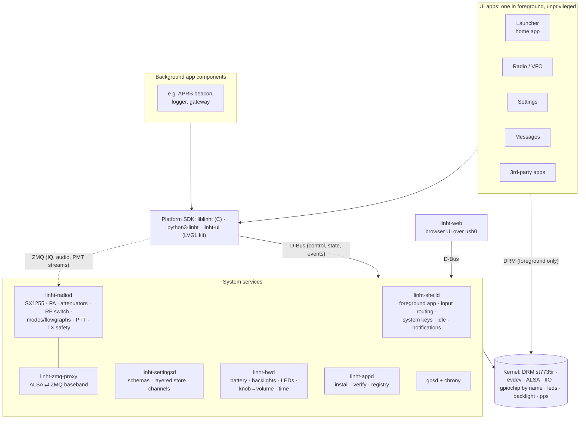
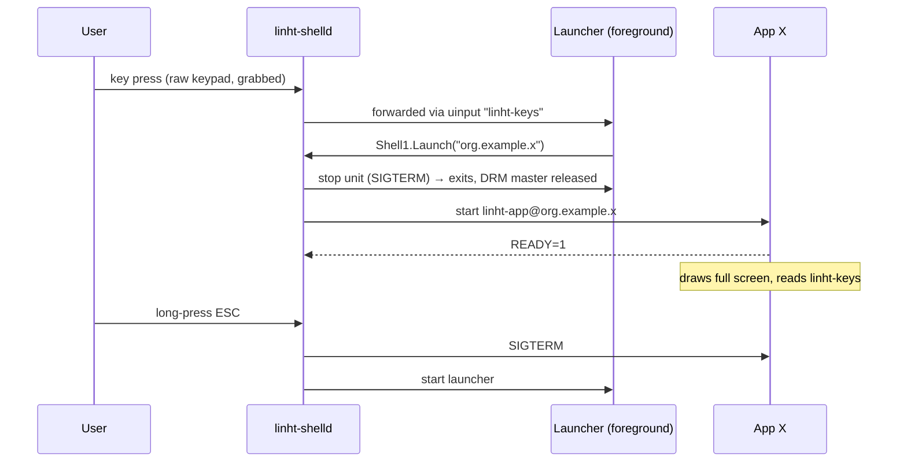

# LinHT app, launcher and settings platform: architecture proposal

Status: **draft, reviewed internally (decisions D1–D29), ready for RFC** · 2026-11-15
Scope: launcher, settings management, app API, app packaging and updates for the LinHT (Rev C, `mcm-imx93`, scarthgap image).

Names in this document (`linht-radiod`, `org.m17project.LinHT.*`, `.lapp`, …) are placeholders. They are meant to be renamed.

---

## 1. Summary

The proposal in nine decisions:

1. **The radio is a system service, not an app.** A new `linht-radiod` takes the RF code out of `gui_test`: SX1255, PA, attenuators, RF switch, flowgraph lifecycle, PTT and TX safety. UI apps become thin clients. This lets the user switch apps without interrupting reception, and puts TX sequencing in one audited place. GNU Radio flowgraphs become first-class, installable **modes**, which keeps the project's "redefine your radio with a flowgraph" idea.
2. **The device tree is the only description of the hardware.** No library, app or config file hardcodes `gpiochipN` numbers, GPIO offsets, `pwmchipN`, or IIO channel numbers. Drivers and line names come from the DT of the board revision. Libraries and example code currently carry older-revision assumptions (§3).
3. **One UI app in the foreground at a time.** `linht-shelld` is a small session manager that draws nothing. It starts one UI app at a time on the single DRM display, routes keypad input, reserves a few system keys, and handles idle, backlight and notifications. The launcher is just the "home" app. A Wayland compositor can be added later without changing the app contract (§6).
4. **Control over D-Bus, data over ZeroMQ.** D-Bus (system bus) carries control, state and events, with per-method permissions through D-Bus policy. ZeroMQ, which the project already uses, carries baseband IQ, audio and PMT streams. Apps use a C or Python SDK and never deal with the wire protocol directly.
5. **Settings are schema-driven and layered, and only `linht-settingsd` writes them.** Each component and app ships a schema. The on-device Settings app and the linht-web settings and CPS pages are both generated from the same schemas. Calibration is kept apart from user preferences and survives reflashing.
6. **There are two package tiers.**
   - **OS image:** Yocto, `.deb` internally. It is updated as a whole, with RAUC A/B later.
   - **Apps:** a signed, declarative bundle (`.lapp`) installed into a data partition. Apps survive OS updates, have no install scripts, and declare permissions.
7. **LVGL 9 is the default UI toolkit** for system apps and app templates. It is already in the image, renders on the CPU into DRM dumb buffers, and has keypad focus navigation built in. raylib stays supported.
8. **Every app component runs as a systemd unit.** Units run unprivileged and sandboxed, with logs in the journal. linht-web's existing services view then shows app logs for free.
9. **Development is incremental (§13).** The RFC and hardware cleanup come first. Then the shell, launcher and settings are prototyped against a mock `radiod`, with `gui_test` as the interim Radio app. `radiod` follows once upstream agrees, then app packaging, and OTA plus community apps last.

---

## Decisions log

Decisions from the design review ("grill-me"), 2026-11-15. Each entry names the sections it affects.

| # | Decision | Affects |
|---|---|---|
| D1 | **Display: one foreground UI app at a time.** `shelld` swaps apps, and switching means stopping one app and starting the next. Each app draws the status bar with an SDK widget. Background work lives in services. A compositor stays a possible later step, so the app contract (160×112 canvas below the status bar) must not depend on the swap model. | §6.1, §6.3, §13 |
| D2 | **Trust: core team first, community later.** v1 apps are trusted and run as `linht`, never root. The manifest declares permissions, and v1 enforces them only for transmit and raw IQ, through D-Bus policy and socket groups. The bundle format and manifest are designed for third parties from the start. The public feed, third-party signing keys, install-time permission prompts and per-app sandboxing come in a later phase. | §9.2, §9.4, §11, §13 (phase 3 slimmed, sandboxing to phase 4) |
| D3 | **API transport: D-Bus (system bus) for control, state and events; ZeroMQ for streams** (IQ, audio, flowgraph PMTs). Apps use the SDK (`liblinht`, `python3-linht`), never raw D-Bus. Until `liblinht` exists (D19), the launcher and Settings app call sd-bus directly. The D-Bus introspection XML is the versioned contract. | §7.1, §7.2, §12 |
| D4 | **PTT is a system function.** PTT always keys voice on the active channel through `radiod`, whichever app is visible. The exception is a foreground app holding a `CapturePTT` lease (`ptt.capture`). Background components may transmit only while the radio is idle (no user TX, no incoming signal) and at lower priority, and the user's PTT always pre-empts them. Each mode must therefore report "channel busy". | §6.2, §7.2, §7.3 |
| D5 | **Background TX uses the current channel only.** `radiod` never retunes or switches mode for a background component. A component that needs another channel or mode gets a "not possible now" error and may retry. Mode and channel changes are always caused by the user (foreground app). | §7.2 (`Acquire`/`Send` semantics), §7.3 |
| D6 | **UI toolkit: LVGL 9** for the launcher, Settings, Messages, the Radio app and app templates. `linht-ui` is built on LVGL. raylib stays a supported choice for apps, mainly graphics-heavy ones and existing code. The desktop simulator uses LVGL's SDL backend. | §6.3, §12 |
| D7 | **Final eMMC layout now, OTA later.** The layout is boot, rootfs A, rootfs B and data, with the data partition mounted at `/var/lib/linht` (and `/home`) from phase 1. Milestone 1 doesn't have it yet (D19): settings are on the rootfs and lost on every reflash. Updates stay a `uuu` reflash until RAUC lands in phase 4. Flashing then needs two variants: **factory**, the full wic image including an empty data partition, and **update**, which writes boot and rootfs only and keeps data. CompuLab's `cl-growfs-rootfs` must grow the data partition instead of the rootfs. | §9.1, §10, §13 (phase 1 gains the WKS/partition work) |
| D8 | **Calibration, serial and revision data live on the data partition** (`/var/lib/linht/factory/`). They survive update flashes, are part of the linht-web backup/export, and are lost on a factory reflash unless backed up. The factory flash flow should offer "back up first". Proposal to hardware: add a small I²C EEPROM to the next board revision. The SoM EEPROM stays CompuLab's, and the stale `2-0054` DT node should be removed. | §3, §8.2 |
| D9 | **Rev C onward only.** There is one DT and one `/usr/share/linht/board/<compatible>.yaml` per revision. The revision comes from the flashed DT (`compatible`), not from runtime detection. Constants for older revisions are deleted from libraries and examples, not kept. | §3, §13 phase 0 |
| D10 | **The Radio app is home, and the launcher is a menu.** The device boots into the Radio app. The "go home" gesture opens the launcher, and ESC in the launcher returns to the home app. The home app is a setting (`system.shell.home_app`, default Radio). | §5 (boot), §6.4 |
| D11 | **Long-press ESC (≥ 1 s) means "go home" in every app.** `shelld` consumes it, and apps never see it. Short ESC stays "back" or "delete character". The SDK's T9 widget uses long-press `#` (`KEY_BACKSLASH`) for "clear all". Apps get no opt-out. | §6.2, §6.3 (T9 widget) |
| D12 | **linht-web is the official remote UI, built on the same D-Bus APIs.** CPS and settings go through `Settings1`/`Channels1`, with forms generated from the schemas. The hardware page goes through `Radio1`, with raw register access only in a "maintenance" state that `radiod` grants (the radio stops, and TX is blocked unless explicitly enabled). An Apps page goes through `Apps1`. linht-web gets a login and binds to `usb0` only. Webshell and file manager remain as developer features. Direct writes to `settings.yaml` and direct SX1255 access are removed. | §2, §8.3, §9.4, §11, §13 |
| D13 | **linht-web login uses a pairing code shown on the LCD.** A new browser triggers a 6-digit code on the radio's screen, shown as a `Shell1` notification. Entering the code pairs the browser with a long-lived, revocable token, listed in Settings → Paired browsers. No default password is involved, and pairing proves physical possession. | §11 |
| D14 | **SDK languages in v1: UI apps in C** (LVGL via `linht-ui`, or raylib), and **background components and modes in C or Python** (`python3-linht` on `python3-sdbus`). Python UIs are deferred, since there is no second UI toolkit to maintain. Flowgraphs stay GNU Radio Python. | §6.3, §12 |
| D15 | **RFC now, prototype in parallel.** This document goes upstream as an RFC (Discord `#linht-dev` plus a GitHub discussion on M17-Project). In parallel, `shelld`, the launcher, `settingsd`, `linht-ui` and the SDK are prototyped in this repo against a **mock `radiod`**. `radiod` is extracted from `gui_test` only after its maintainers agree. The DT cleanup (§3) is part of the RFC, since it touches `meta-linht-hardware`. | §13 (phase order) |
| D16 | **In the interim, `gui_test` is the Radio app.** Until `radiod` exists, `shelld` runs the unmodified `gui_test` as the home app, still as root. Two changes are needed, carried as local patches (D30). (1) `gui_test` reads `/dev/input/linht-keys` instead of `/dev/input/keypad`, and leaves the main loop when that device disappears: the kernel then drops the queued releases, so a held PTT would never be released. (2) **`gui_test` gets a SIGTERM handler** that leaves the main loop so its existing cleanup runs: PA off, RF switch to RX, flowgraph stopped. Today SIGTERM kills it without cleanup. `linht-gui-test.service` is bound to `shelld` (`BindsTo=`), so it stops, with that cleanup, whenever `shelld` stops or crashes. Also, `shelld` doesn't switch apps while PTT is held. Known limitation: leaving the Radio app stops the radio until `radiod` lands. | §13 (prototype) |
| D17 | **Naming prefix is `org.m17project.LinHT`.** D-Bus interfaces use it (`org.m17project.LinHT.Radio1`, object paths `/org/m17project/LinHT/…`). System app IDs use the lowercase form (`org.m17project.linht.launcher`, `.radio`, `.settings`, `.messages`). Settings namespaces stay short (`system.*`, `radio.*`, `rf.*`, `app.<id>`). The bundle extension (`.lapp` placeholder) is decided in the RFC. | §7, §9.2 |
| D18 | **OpenRTX would be an app on top of `Radio1`.** If OpenRTX's UI is ported, it becomes a UI app (possibly the home app) with a `linht` platform target whose HAL talks to `radiod` through the SDK. It never drives the hardware directly. `Radio1` should therefore cover what an OpenRTX HAL needs (tune, mode, PTT, RSSI, squelch, channel busy). | §7.2, §14 |
| D19 | **Milestone 1 is a thin vertical slice:** `shelld`, LVGL launcher, `settingsd` with schemas and YAML store, a schema-generated Settings app, `linht-ui` basics, `gui_test` as home app (D16), and the simulator with mocks. **Done when:** the device boots into `gui_test`, long-ESC opens the launcher, a brightness change in Settings applies live, and ESC returns to the radio. **Milestone 1 is not all of phase 1.** Phase 1 still owes: the data partition (D7), the mock `radiod`, `liblinht` (until then apps call sd-bus directly, D3), linht-web v2 W1, and `shelld` as the non-root `linht-shell` user (milestone 1 runs it as root). | §13 phase 1 |
| D20 | **Licensing: all LinHT components are treated as GPL-3.0** (LinHT-utils incl. `gui_test`, linht-web, linht-share, liblinht-ctrl). Code may move freely between them, so `radiod` can reuse `gui_test` code. This repo is GPL-3.0-only, matching `liblinht-ctrl.bb`, and the `LICENSE` file is in the repo root. The `CLOSED` recipe metadata is corrected in phase 0. | §13 phase 0, §14 |
| D21 | **App bundle extension is `.lapp`** (zstd-compressed tar archive plus ed25519 signature). | §9.2 |
| D22 | **No performance budget is set up front.** App-switch time and memory per app aren't milestone criteria. | §6.1, §13 |
| D23 | **Connectivity is "PC over `usb0`"**, possibly plus a USB-C network dongle. No Wi-Fi or BT is assumed. The app feed and updates are offline-first. | §9.4 |
| D24 | **OS updates go through linht-web.** The user uploads a signed RAUC bundle in the browser, linht-web hands it to RAUC, and the device installs into the inactive slot and reboots. SD-card updates are not a supported path. | §9.1, §13 phase 4 |
| D25 | **Storage formats follow existing usage: YAML for configuration, SQLite for records.** YAML is used for the settings layers, factory calibration, state, schemas, manifests and mode descriptors. SQLite is used for messages (existing `messages.db`, schema kept and versioned through `user_version`) and for channels and contacts (`channels.db`). Every file has exactly one owning service. | §8.5, §10 |
| D26 | **linht-web is rewritten as v2** in this repo under `web/` (D30), designed in [linht-web-v2.md](linht-web-v2.md). It stays Go, moves to stdlib `net/http`, and has no data or hardware of its own: everything goes through D-Bus. It runs as `linht-web` behind a socket bound to `usb0`, with pairing, CSRF and DNS-rebinding protection. Shell, whole-filesystem access, containers and radio maintenance are developer-mode only, and developer mode can only be switched on the device. Vendored frontend, no CDN. It ships in milestones W1–W4 alongside phases 1–4. | §7.2, §8.3, §11, §13 |
| D27 | **Monorepo with CMake.** `shelld`, launcher, `settingsd`, `linht-ui`, `liblinht`, schemas, D-Bus XML, mocks and the simulator live in this repo, as one CMake project with a target per component. The same tree builds for the device and for the PC simulator. | §12, §13 phase 1 |
| D28 | **Yocto recipes live in this repo** (`contrib/yocto/`, added to `bblayers.conf` as a layer) during prototyping. Kernel config and DT changes are carried there as `bbappend`s for `linux-compulab`, and gui_test patches as a `linht-utils` `bbappend` that pins `SRCREV`. What goes upstream, and when, is D30. | §13 phases 0–1 |
| D29 | **Development process.** It is defined in `AGENTS.md`, which `CLAUDE.md` imports. ponytail sets the scope, and TDD applies to non-trivial logic. Every milestone is reviewed by a fresh **Claude Fable 5.2** `milestone-reviewer` subagent. Findings are fixed, and the full milestone is re-checked by new reviewer instances until a round reports `RESULT: NO FINDINGS`. Each round is logged in `docs/reviews/`. Agent skills are copied into `.claude/skills/`, pinned and read before adoption (`VENDORED.md`). | §13, AGENTS.md |
| D30 | **One repo, and upstream changes as patches.** Everything lives in [OE3ANC/linht-platform](https://github.com/OE3ANC/linht-platform): the platform, the Yocto layer (`contrib/yocto/`) and linht-web v2 (`web/`, instead of the `v2` branch of OE3ANC/linht-web). Upstream components (kernel config, DT, keypad driver, `gui_test`) are changed only through patches and `bbappend`s in `contrib/yocto/`, never through forks, and each patch states its `Upstream-Status`. For now nothing is sent upstream as a PR: the RFC links to the patches here. **The `gui_test` patches never go upstream** (`Inappropriate`), because the LVGL Radio app replaces `gui_test` in phase 2. **The keypad driver fix stays here until then too**: upstream on its own, it would make the unpatched `gui_test` key PTT on release. | §3, §13, D16, D26, D28 |

---

## 2. Current state

Taken from the running device (`10.17.17.17`) and from `meta-linht-{hardware,software,sdr}`.

| Area | Today | Consequence |
|---|---|---|
| Default UI | `gui_test` (`linht-gui-test.service`, root), the "Interface Daemon" in the project's blog posts | It is a monolith. It owns the SX1255 (spidev), attenuators, PA and RF-switch GPIOs, the keypad evdev, the DRM display (raylib), and the flowgraph child process (`python som_m17_ptt.py …`). It also writes the message DB (`/var/lib/linht/messages.db`) and reads the battery and knob ADC. Nothing else can use the radio while it runs, and killing it can leave RF in an undefined state. |
| Display | ST7735R 160×128 over SPI (`st7735rdrmfb`, `/dev/dri/card0`), one CRTC, one plane, no GPU (raylib uses Mesa software GL) | Only one process can be DRM master, so overlays from a second process are impossible without a compositor. `gui_test` uses 82 MB RSS, mostly Mesa. |
| Input | `/dev/input/keypad` (custom polling `matrix-keypad` module): arrows, ENTER, ESC, 0–9, `*`, `\` (#), PTT (`KEY_P`, internal or external PTT), OPT side button (`KEY_O`). The power key is a separate device (`event0`). The driver polls every 20 ms and has no autorepeat or long-press support. | There is no Home key, so "back to launcher" needs a reserved gesture. PTT and OPT arrive on the same device as normal keys. Long-press and autorepeat have to be done in userspace. |
| Settings (YAML) | `/usr/share/linht/settings.yaml` from LinHT-share, byte-identical to upstream HEAD on this device. It holds calibration, front-end gains, user preferences and the last-used VFO together. `gui_test` reads it once at startup with libcyaml, against a strict schema: every field is required and unknown keys are rejected. linht-web's CPS plugin is the only writer. It edits the file through the yaml.v3 node API, which keeps key order and comments, and saves with a plain `os.WriteFile`. | The file sits in `/usr` (image-owned), so a reflash or package update overwrites calibration. Adding or removing any key makes `gui_test` fail at startup, so the file can't evolve without lockstep releases. The save is not atomic, so a power loss mid-write leaves a truncated file. There is no locking or change notification, and changes only apply when `gui_test` restarts. `timezone: 2.0` is a float offset, not a tz name. |
| Messages (SQLite) | `/var/lib/linht/messages.db`: SQLite 3.45 in WAL mode, one table `messages(id, timestamp, protocol, source, destination, meta BLOB, message, read)`, `user_version` 0, no indexes. `gui_test` keeps it open and inserts received M17 SMS. The `m17-packet-sqlite` tool writes the same table and creates the schema on its own. linht-web doesn't use it. | A sound basis to keep. But the schema is defined in two programs and has no version, so migrations need `user_version`. Received messages are stored with `read = 1` (they're shown at once), so the unread count is always 0. Sent messages aren't stored. Timestamps suffer from the clock problem below. |
| Hardware constants | Duplicated in `liblinht-ctrl.h`, `gui_test`, `linht-web/config.yaml` (`hardware:`) and `scripts/*.sh` | This is the revision-drift problem (§3). |
| Hardware access from the web | linht-web's `hardware` plugin writes SX1255 registers, gains, RF switch and attenuators directly | `gui_test` is not coordinated with it and doesn't know its state changed. That is a second RF owner. |
| Radio data path | `zmq_proxy` (ALSA `hw:SX1255` ⇄ ZMQ `ipc:///tmp/bsb_rx`, `/tmp/bsb_tx`). PTT is SOT/EOT PMTs on `ipc:///tmp/ptt_msg`. Flowgraph aux data uses `ipc:///tmp/fg_aux_data_{in,out}`. | This is a good basis to keep. The endpoints should move from `/tmp` to `/run/linht/` with group permissions. |
| Volume | `volume_ctrl.sh` polls the ADC every 200 ms and forks `awk` and `amixer` | It costs a constant ~1.2 % CPU, and the volume isn't visible to the UI. |
| Packages | `PACKAGE_CLASSES = package_deb`, with `package-management` enabled: dpkg holds 1290 packages and apt is present, but no feed is configured. This setting comes from this build's `local.conf`, not from the layer, so other builds may use ipk or rpm. There is a single rootfs partition with no A/B. Updates mean reflashing with `uuu`. | apt could serve as a developer feed, but there is no update story for users yet. |
| Container add-ons | `OE3ANC/linht-docker-template` builds `linht-arm64.tar` images, which linht-web can import. Imported containers get only image, name, env and cmd: no devices, volumes or ports. | This is already a working add-on path for server-style software. |
| Containers | `dockerd` + `containerd`, needed by linht-web (`Requires=docker.service`) | They take about 120 MB RSS and are always started at boot. |
| Time | The RTC reads 1970 and system time starts at 2024-02-27 on every boot. NTP is disabled. A GNSS receiver (Quectel LG77L on `ttyLP2`, 9600 baud) and a PPS line (`GPIO4_IO08`) exist. On Rev C the RTC sits on the always-on rail. | Message timestamps are wrong. Setting the clock once from GNSS would let the RTC keep time across power cycles. |
| First boot | `linht-first-boot.sh` runs `grcc` on the device, sets ALSA levels, runs `fw_setenv`, then reboots | Flowgraph compilation belongs at build time, and mixer defaults belong in a state file. |
| Privileges | Everything runs as root | No app can be sandboxed. |

Boot currently takes 1.9 s (kernel) + 9.2 s (userspace) to `multi-user.target`.

---

## 3. Hardware abstraction, and why it comes first

Libraries and examples still encode the layout of older hardware revisions. The Rev C device tree in `meta-linht-hardware` is the only maintained description. The following were found while comparing them:

- **`liblinht-ctrl` addresses controllers by enumeration order.** It uses `/dev/gpiochip0..3` for GPIO2/3/4/1 and `/sys/class/pwm/pwmchip0` and `pwmchip4` for TPM3 and TPM4. Any change in probe order, or any new GPIO expander, silently retargets the pins.
- **Its comments contradict the code.** `linht_ctrl_tx_rx_switch_set(bool tx_mode) // true=RX, false=TX`, but `gui_test` passes `true` for TX. Several pin comments name the wrong pad: TX_RX says `GPIO_IO13` while the DT says `GPIO2_IO15 RF_SW_CTRL`, and LE1 says `TPM3_CH2`.
- **`gui_test`'s TX path only toggles the SX1255-internal PA bit.** The board's `RF_PA_ENABLE` (`GPIO3_IO25`) is set to `false` at start and never enabled. Someone needs to check whether that is intended on Rev C.
- **The battery formula appears in at least two places.** It is 12-bit, 1.8 V ref, 39k/10k divider, with 7.4 V and 7.0 V thresholds, in both `gui_test` and `scripts/batt_volt.sh`. A BQ25792 charger script also exists (default `/dev/i2c-2`, `0x6b`). Which of these is valid for Rev C needs checking.
- **linht-web keeps a third copy of the RF pins** (`reset_pin: 22`, `tx_rx_pin: 15`, attenuator `6/7/12/13`).
- **The baseband sample rates disagree.** `zmq_proxy` opens the SX1255 ALSA device at a hardcoded 500 kHz, while `settings.yaml` (`rf_sample_rate: 125`) and the flowgraphs use 125 kHz.
- **The LCD backlight was verified on Rev C** (2026-11-15, by eye):
  - `pwmchip0` is TPM3 (`424e0000.pwm`), channel 3, on pad `GPIO_IO24` (LCD_PWM).
  - At 20 kHz the brightness follows the duty cycle with normal polarity: 10 % is almost off, 90 % is about full brightness. There is no flicker.
  - With the PWM disabled, the backlight is fully on, which is the state today because nothing drives it.
- **The keypad backlight was verified on Rev C** the same way: `pwmchip4` is TPM4 (`424f0000.pwm`), channel 3, on pad `GPIO_IO25` (KBD_PWM), and it behaves exactly like the LCD backlight. That is normal polarity at 20 kHz, 10 % dim, 90 % about full, and fully on while the PWM is disabled.
- **DT nodes to add:**
  - LCD: `backlight { compatible = "pwm-backlight"; pwms = <&tpm3 3 50000 0>; … }`, referenced from the panel node.
  - Keypad: `pwm-leds { compatible = "pwm-leds"; led-kbd { pwms = <&tpm4 3 50000 0>; label = "linht::kbd_backlight"; max-brightness = <255>; default-state = "on"; }; }`.
  - Both are implemented in `contrib/yocto/recipes-kernel/linux/files/linht-platform.dtsi`. They show up as `/sys/class/backlight/backlight-lcd` and `/sys/class/leds/linht::kbd_backlight`.
  - With both nodes, brightness goes through `/sys/class/backlight` and `/sys/class/leds`, and the enumeration-dependent `pwmchipN` paths disappear from userspace.
- **The keypad driver inverted every key on Rev C** (found 2026-11-15, during milestone 1):
  - **Cause:** the DT marks the column, PTT and OPT GPIOs `GPIO_ACTIVE_LOW`, so `gpiod_get_value()` already returns 1 while a key is pressed. The out-of-tree `matrix-keypad.c` inverted it once more. Every key therefore reported 0 on press and 1 on release, and at module load every key was reported as pressed.
  - **Who was affected:** gui_test had worked around it (`KEY_PRESS 0`). Every standard reader saw keys stuck down: LVGL repeated the last key forever, and shelld's long-press and timeouts were inverted.
  - **Fix:** `contrib/yocto/recipes-kernel/matrix-keypad/` (patch 0001) gives standard evdev values. It ships together with linht-utils patch 0003 (gui_test `KEY_PRESS 1`), because either one alone would make PTT key the transmitter on release. Both stay in `contrib/yocto` until the LVGL Radio app replaces gui_test (D30).
- **LVGL 9.1's DRM driver hangs on panels smaller than 800×480.** `lv_linux_drm_create()` creates an 800×480 display, and `lv_linux_drm_set_file()` sets the panel-sized buffers before the real resolution. The always-on buffer-size assertion fails, and the assert handler is `while(1);`. linht-ui sets the resolution first as a workaround. Upstream: update LVGL in meta-oe.
- **meta-oe's `liblvgl.so` and `lvgl.pc` aren't linked against libdrm**, although the DRM driver is built in. Apps have to link libdrm themselves (see `apps/CMakeLists.txt`).
- **The DT has no `gpio-line-names`.** LEDs, flashlight and the LCD and keypad backlights aren't kernel devices. `/sys/class/backlight` is empty and `/sys/class/leds` only has `heartbeat-led`. Userspace bit-bangs them.

**Proposal:**

1. **Describe everything in the DT** of the board revision:
   - `gpio-line-names` on every GPIO controller (`RF_SW_CTRL`, `RF_PA_ENABLE`, `RF_ATT_LE1`, `RF_RST`, …). Userspace then requests lines **by name** through libgpiod (`gpiod_chip` line-name lookup, or `gpiofind`).
   - `gpio-leds` for the red and green LEDs and the flashlight (`/sys/class/leds/linht:red:tx`, …).
   - `pwm-backlight` for the LCD, linked from the panel node so DRM blanking also switches the backlight. Use `pwm-leds` for the keypad backlight. The kernel already has `CONFIG_BACKLIGHT_PWM=y` and `CONFIG_LEDS_GPIO=y`.
   - `pps-gpio` for GNSS PPS (`CONFIG_PPS_CLIENT_GPIO=y` is already set).
   - Labelled IIO channels (battery, knob) via a consumer node such as `io-channel-names`, instead of `in_voltage1_raw` in code.
   - Optionally, replace the out-of-tree polling `matrix-keypad` with mainline `gpio-matrix-keypad` + `gpio-keys` (PTT, ext PTT, OPT, jack detect as `SW_HEADPHONE_INSERT`), with the keymap in the DT. Each revision then has its own keymap and no driver fork.
2. **Board identity (D8, D9).** Give each revision from Rev C on its own DT `compatible` and `model`, e.g. `"m17,linht-revc"`; today the model string is just `LinHT`. The board has no EEPROM of its own, so the revision comes from the flashed DT, and serial and calibration live on the data partition. The `2-0054` EEPROM node inherited from CompuLab's DT never binds and should be removed. The next board revision should get a small I²C EEPROM.
3. **Only `linht-radiod` and `linht-hwd` touch hardware.** `liblinht-ctrl` becomes a private helper that resolves names, or is folded into those two daemons. Apps never link against it. Anything that can't be expressed in the DT goes into one per-revision file, `/usr/share/linht/board/<compatible>.yaml`, selected by `compatible`.
4. **Pin `SRCREV`s.** Most LinHT recipes track `AUTOREV`, so an image can mix code written for different revisions without anyone noticing.

---

## 4. Overview



| Component | Language (suggested) | Runs as | Replaces / absorbs |
|---|---|---|---|
| `linht-radiod` | C (links libsx1255, libgpiod, libzmq, sd-bus) | `linht-radio` user, with udev-granted access to spidev and RF GPIO lines | RF parts of `gui_test`, PTT SOT/EOT logic, flowgraph spawning |
| `linht-zmq-proxy` | C (exists) | `linht-radio` | unchanged, endpoints move to `/run/linht/zmq/` |
| `linht-hwd` | C | `linht-hw` user | `volume_ctrl.sh`, battery code in `gui_test`, backlight code in `liblinht-ctrl` |
| `linht-settingsd` | C or Python | `linht-settings` | direct YAML edits by `gui_test` and linht-web |
| `linht-shelld` | C | `linht-shell` (needs `input` and uinput); root in milestone 1 (D19) | ESC-5 s exit and the "secret combo shutdown" in `gui_test` |
| `linht-appd` | C or Python | root (installs files, creates units), small surface | — |
| Messages (`msgd`, or part of `radiod`) | C | `linht-radio` | SQLite code in `gui_test` (schema kept) |
| Launcher, Radio, Settings, Messages | C + LVGL | `linht` (uid 1200) or per-app user | `gui_test` UI |
| linht-web v2 ([design](linht-web-v2.md)) | Go | `linht-web` (socket-activated, `usb0` only) | linht-web v1 (root, direct file and hardware access) |

Five or six small daemons can look like a lot for a handheld. The split follows privilege (RF, power, input, files) and failure isolation: a settings bug must never key the transmitter. If memory or boot time becomes an issue, `hwd` and `settingsd` can be merged into one process without changing the APIs.

---

## 5. Process and lifecycle model

Every app component (UI or background service) runs as a systemd unit generated from its manifest:

- `linht-app@<id>.service` (template) or a transient unit started by `shelld` through `org.freedesktop.systemd1.StartTransientUnit`.
- Unit properties come from the manifest permissions: `User=linht` (v1) or `DynamicUser=yes` (later), `SupplementaryGroups=`, `ProtectSystem=strict`, `ProtectHome=yes`, `PrivateTmp=yes`, `ReadWritePaths=/var/lib/linht/appdata/<id>`, `DeviceAllow=char-drm rw` (UI only), `MemoryMax=`, `Restart=` (services).
- The environment provides `LINHT_APP_ID`, `LINHT_APP_DIR`, `LINHT_DATA_DIR`, `LINHT_CACHE_DIR`, `LINHT_API_LEVEL`.
- Logs go to journald. linht-web's services plugin already filters on a `linht-` prefix, so app logs show up there automatically.

**UI app lifecycle:** start → optional `sd_notify("READY=1")` → foreground → SIGTERM on close or switch (2 s grace, then SIGKILL). If the app crashes, the shell returns to the launcher with a toast ("Spectrum stopped unexpectedly"). Apps must keep no state that can't be lost at SIGTERM. Long-lived state belongs in settings, `appdata`, or a background component.

**Background components** are started at boot if enabled, or on demand through D-Bus or socket activation. They must not touch the display.

**Boot order:** `linht.target` pulls in `hwd`, `settingsd`, `zmq-proxy`, `radiod` and `shelld`. `shelld` then starts the home app. `radiod` restores the last mode and channel by itself, so the radio receives even before any UI is up.

---

## 6. Display and input: `linht-shelld`

### 6.1 Display ownership (v1: exclusive foreground)

The ST7735R is a single-plane tinydrm device. Only the DRM master can scan out, and closing the DRM fd releases master. So:

- `shelld` never opens the display. It only decides which UI unit runs.
- A switch means stopping the current UI unit, which exits and releases DRM, then starting the next one. The launcher is an ordinary UI app (the "home app").
- Since the radio, messages and GNSS live in services, killing a UI app loses nothing. Switching apps costs one app start. There is no formal performance budget (D22).



**Status bar.** The top 16 px are reserved for system status: time, TX/RX, unread messages, GNSS, battery. In v1 the foreground app draws it with an SDK widget fed from the `Status` properties on D-Bus. That keeps the look consistent with one line of code (`linht_ui_statusbar_create()`). Notification sound, LED patterns and vibration-less alerts are produced by `shelld` and `hwd`, so every app gets them without doing anything.

**Later (v2, only if needed): compositor.** If true overlays or instant switching become requirements, add a small Wayland compositor. Weston 12 (meta-imx) with the pixman renderer is available. A tiny wlroots-based shell would need an extra layer. Apps then run as Wayland clients through LVGL's Wayland driver or SDL2. The app contract is written so this switch doesn't break apps: an app gets a **160×112 canvas below the status bar** and keys from the system. In v1 the SDK enforces this by clipping. In v2 the compositor hands the app a 160×112 surface.

### 6.2 Input routing

`shelld` takes an exclusive grab (`EVIOCGRAB`) on `/dev/input/keypad` and re-emits non-system events on a virtual **uinput** device `linht-keys`, with a udev symlink `/dev/input/linht-keys`. Foreground apps see an ordinary evdev keyboard, so LVGL's `lv_evdev`, raylib DRM and SDL work unmodified. raylib DRM scans `/dev/input/event*`, and the grabbed raw device delivers nothing to it.

> Kernel change needed: `CONFIG_INPUT_UINPUT` is **not set** in the upstream kernel (`custom_defconfig.cfg` in meta-linht-hardware). `contrib/yocto` sets it (`linht-platform.cfg`).

Because `shelld` sees every event first, it also does the **long-press detection** the keypad driver lacks.

`linht-keys` has **no kernel autorepeat** (`EV_REP`) while gui_test is the Radio app. gui_test treats any value other than a press, including a repeat (2), as a release, so a held PTT would stop transmitting. LVGL repeats held keys itself.

| Key | System behaviour | Delivered to app? |
|---|---|---|
| PTT (`KEY_P`) | `radiod` transmits on the active channel, if TX is allowed (§7.2) | Only while the foreground app holds a `CapturePTT` lease (permission `ptt.capture`), e.g. CW keyer or packet app |
| ESC long (≥ 1 s) | Go to launcher (from launcher: back to home app) | Short press: yes |
| OPT side key | Long press: user-assignable system action (flashlight, monitor/squelch open, …) | Short press: yes (app "context menu" key) |
| `*` long | Keypad lock | Short press: yes |
| Any key while screen is off | Wakes the screen. PTT then works as usual; any other key is swallowed, release included | PTT only |
| Power key (`event0`) | logind poweroff (already configured) | No |

The volume knob is not an input device. `hwd` maps it to the codec (absorbing `volume_ctrl.sh`) and publishes a `Volume` property.

**Idle policy:** `shelld` applies `system.display.timeout` and `system.keypad.backlight_timeout` through `hwd`. Until `hwd` exists (phase 2), `shelld` writes `/sys/class/backlight` and `/sys/class/leds` itself. Apps can hold an idle inhibitor (`Shell1.InhibitIdle` → fd, released when closed), e.g. for a waterfall view.

### 6.3 UI toolkit

- **LVGL 9** (already in the image as `lvgl 9.1`, `PACKAGECONFIG drm`, evdev on) is the default for the launcher, Settings, Messages and app templates. It has keypad focus groups, lists, rollers and text areas, a theme engine, and CPU rendering into DRM dumb buffers without Mesa. It also has an SDL backend, which the desktop simulator uses (§12).
- **raylib** stays supported, for existing code and graphics-heavy apps or games. Its memory cost (Mesa software GL) should be documented.
- **`linht-ui`** is a small kit on top of LVGL: theme, 160×128 layouts, status bar widget, soft-key hint row, T9 text entry (libm17-t9 is already packaged), and frequency and callsign input widgets.
- **Python UIs: deferred (D14).** v1 UI apps are C. Python is first-class for background components, modes and flowgraphs. A Pillow-based `linht.ui` can be reconsidered once the LVGL look is settled.
- **T9 entry (D11):** short ESC deletes a character, and long-press `#` clears the field. Long ESC always goes home.

### 6.4 Launcher UX (160×128, keypad only)

```
┌──────────────────────────────┐ 160 px
│12:34   TX  ✉2  ⌖     7.6V    │ status bar, 16 px (system)
├──────────────────────────────┤
│ 1  Radio                     │
│ 2  Messages            (2)   │
│ 3  Settings                  │ 6 rows × 16 px
│ 4  GNSS                      │ UP/DOWN focus, ENTER open,
│ 5  Spectrum                  │ 1–9 quick-launch
│ 6  APRS                      │
├──────────────────────────────┤
│ ESC back            OK open  │ soft-key hints, 16 px
└──────────────────────────────┘ 128 px
```

- The **home app** is configurable and defaults to Radio, as on a normal handheld. The launcher is a menu, not the boot screen.
- Entries come from app manifests: name, icon (16×16 and 32×32 PNG), category and sort order. Favourites map to number keys.
- Badges (unread count) come from D-Bus properties the app or its service exports through `Shell1`.

---

## 7. System service APIs

### 7.1 Transport

- **D-Bus system bus** carries all control, state and events:
  - It is already running, and `libsystemd`'s **sd-bus** is in the image.
  - Python has `python3-sdbus`, `python3-dbus-next` and `python3-dbus` in the layers. Go (linht-web) has godbus.
  - Introspection makes debugging easy (`busctl`).
  - fd-passing enables leases that free themselves when a client crashes.
  - **D-Bus policy** gives per-method permissions by user or group, which is how manifest permissions get enforced.
- **ZeroMQ** carries streams: baseband IQ (existing), per-mode aux data (PMT), and decoded audio. Endpoints move to `/run/linht/zmq/…` with group ownership (`linht-iq`, `linht-audio`). GNU Radio speaks ZMQ natively, so flowgraphs need no glue.
- Alternatives considered:
  - Plain ZMQ REQ/REP + JSON: the team knows it, but it has no ACLs, no introspection and no fd passing.
  - varlink: lean, but a smaller ecosystem.
  - gRPC: too heavy for this device.

Interfaces are versioned by name (`Radio1` → `Radio2` on a breaking change). An integer **API level** names a set of interface versions plus the libraries the image guarantees (§9.3).

### 7.2 Interfaces (sketch)

```text
org.m17project.LinHT.Radio1          /org/m17project/LinHT/Radio        (linht-radiod)
  props   State s ("idle"|"rx"|"tx"|"error"), Mode s, RxFrequency u, TxFrequency u,
          Rssi d, Squelch b, TxAllowed b, TxInhibitReason s, Owner s
  ListModes()                         → a(ssa{sv})   id, name, capabilities
  SetMode(s mode, a{sv} params)                       e.g. "m17.voice", {dst:"@ALL", can:0}
  Tune(u rx_hz, u tx_hz)
  Transmit(b on)                                      [radio.tx]   normally driven by PTT
  Send(s kind, a{sv} payload)         → t id          [radio.tx]   e.g. "m17.sms" {dst, text}
  Acquire(s reason, i priority)       → h lease       exclusive mode/tune control until fd closed
  StreamEndpoints()                   → a{ss}         ZMQ addresses for IQ/audio/aux of current mode
  signal StreamStarted(a{sv})  StreamEnded()  PacketReceived(a{sv})
  signal TxStateChanged(b on, s reason)  ModeChanged(s)
  EnterMaintenance(b allow_tx) → h lease  [developer mode] stops the mode; raw access until fd closed
  ReadRegister(y addr) → y   WriteRegister(y addr, y val)
  SetAttenuator(y chip, d db)   SetRfSwitch(b tx)       maintenance lease holder only

org.m17project.LinHT.Settings1       (linht-settingsd)
  Get(s ns, s key) → v     GetAll(s ns) → a{sv}
  Set(s ns, s key, v)      SetMany(s ns, a{sv})       atomic, validated against schema
  Reset(s ns, s key)       Describe(s ns) → (s title, a(sa{sv}) keys)   schema for generic UIs
  ListNamespaces() → as    Export() → h   Import(h)   backup/restore (settings + channels, phase 2)
  signal Changed(s ns, a{sv} values)                  new effective values, resets included
  # authoritative: interfaces/org.m17project.LinHT.Settings1.xml + docs/settings-schema.md

org.m17project.LinHT.Channels1       (linht-settingsd)    channel memories / codeplug
  List(s zone) → aa{sv}   Get/Put/Delete(s id)   Import(h csv)   Export() → h
  signal Changed(as ids)

org.m17project.LinHT.Messages1       (msgd / radiod)
  List(u offset, u count, a{sv} filter) → aa{sv}   MarkRead(t id)   Delete(t id)
  Send(s proto, s dst, s text) → t id              [messages.send → radio.tx]
  props   Unread u
  signal Received(t id, a{sv})  StatusChanged(t id, s status)

org.m17project.LinHT.Hardware1       (linht-hwd)
  props   BatteryVoltage d, BatteryPercent y (estimated from a 2S voltage curve: no fuel gauge),
          Charging b (BQ25792), Volume y, Temperature d,
          JackInserted b, TimeSource s ("rtc"|"gnss"|"manual")
  SetFlashlight(b)                                  [hw.flashlight]
  Signal(s pattern)                                 LED/beep patterns for notifications

org.m17project.LinHT.Shell1          (linht-shelld)
  Launch(s app_id, as args)   Home()   ListApps() → aa{sv}
  Notify(a{sv}) → u id        title, body, icon, urgency, sound, led, action(app_id)
  InhibitIdle(s reason) → h   CapturePTT() → h     [ptt.capture, foreground only]
  SetBadge(s app_id, u n)
  props   Foreground s            (changes via PropertiesChanged)
  signal  NotificationAdded(u, a{sv})
  # milestone-1 subset is authoritative in interfaces/org.m17project.LinHT.Shell1.xml

org.m17project.LinHT.Apps1           (linht-appd)
  Install(h bundle_fd) → o job   Remove(s id)   List() → aa{sv}   Rollback(s id)
  SetEnabled(s id, s component, b)
  ListUnits() → aa{sv}   ControlUnit(s unit, s action)   limited to linht-* and linht-app@* units
  signal JobProgress(o job, u percent, s state)
```

For GNSS, apps use **gpsd** directly (`libgps`, or JSON on `/run/gpsd.sock`), since it is already installed. `hwd` feeds GNSS and PPS time to the system clock through **chrony** with SHM/PPS refclocks and no network. This also fixes the 1970 RTC and wrong message timestamps.

### 7.3 `linht-radiod` responsibilities

- **Hardware ownership:** SX1255 init and tuning (with `rf.calibration.freq_corr`), gains, attenuators, PA and RF-switch sequencing, red TX LED. This logic lives here and nowhere else.
- **Modes** (radio "plugins"): a mode is a pre-compiled flowgraph plus a descriptor. `grcc` runs at build time, not on first boot. Built-in modes live in `/usr/share/linht/modes/`, and apps can ship more.
  ```yaml
  # modes/m17-voice.yaml
  id: m17.voice
  name: M17 Voice
  flowgraph: som_m17_ptt.py          # generated by grcc at build time
  capabilities: [rx, tx, voice, text]
  sample_rate: 125000
  params:                            # how radiod builds the flowgraph command line
    src:  { from: radio.operator.callsign, arg: "-S" }
    dst:  { type: string, default: "@ALL", arg: "-D" }
    can:  { type: int, min: 0, max: 15, default: 0, arg: "-C" }
    dc:   { from: rf.calibration.dc_offset, arg: "-o" }
  zmq:                               # passed to the flowgraph, no hardcoded /tmp paths
    aux_in:  "{run}/zmq/m17.voice/aux_in"
    aux_out: "{run}/zmq/m17.voice/aux_out"
  ```
  Flowgraphs should take their ZMQ endpoints as parameters. Today they are hardcoded in the `.grc` files.

  **Drag-and-drop modes.** Today users SSH in and `git pull` new flowgraphs. A **mode-only bundle** should therefore be the easiest thing to make: a `.grc` plus a short descriptor, with no compiled code. Two ways to produce one:
  - Upload a `.grc` in linht-web. It asks for name and parameter mapping, generates the descriptor, and installs the result as a bundle.
  - Install a bundle that ships a `.grc` without a precompiled `.py`. `appd` then runs `grcc` in a sandbox at install time.
- **PTT and TX safety:**
  - TX only if a callsign is set (not the `L1NHT` placeholder) and the frequency is inside the configured band plan or licence region.
  - A TX timeout timer runs on every transmission.
  - TX is inhibited on low battery or over-temperature.
  - The PA is enabled only after the RF switch confirms TX.
  - `WatchdogSec=` on the unit, plus an `ExecStopPost=` fail-safe helper (`linht-rf-safe`): PA off, switch to RX, LED off. Today, if `gui_test` dies while transmitting, the PA state is undefined.
- **Arbitration:** one owner at a time through `Acquire()` leases (fd-based, so a crash frees them). Background TX components (beacons) get lower priority than the foreground app and are told when they lose the radio.
- **Messages:** M17 packet and SMS decoding feeds the messages store. The existing `messages` SQLite schema is kept.

---

## 8. Settings management

### 8.1 Requirements

Settings need a schema with types, ranges and defaults; several layers; one writer; atomic writes; change notifications; and generated UIs (keypad and web). Calibration must stay separate from preferences and survive updates and reflashing. Runtime state such as the last frequency must not wear the eMMC.

### 8.2 Layers (lowest to highest priority)

| Layer | Location | Written by | Survives |
|---|---|---|---|
| Schema defaults | `/usr/share/linht/schemas/*.yaml`, `<app>/settings.schema.yaml` | image / app bundle | — |
| Board / factory | `/var/lib/linht/factory/*.yaml` on the data partition (D8): RF calibration and serial | calibration tool only (`factory` access) | update flashes, OS update and app removal. Included in backup/export, but lost on a factory reflash unless backed up. |
| User | `/var/lib/linht/settings/<namespace>.yaml`: only keys that differ from default | `settingsd` | OS update |
| Runtime state | `/var/lib/linht/state/*.yaml`: last mode, channel, VFO, volume | owning service, writes debounced | OS update |

Secrets such as M17 encryption and signing keys go into `/var/lib/linht/secrets/` with mode 0600. They are never returned by `GetAll` and are only readable by the owning service.

### 8.3 Schema format

The exact format, the types, the store and the D-Bus behaviour are specified in [settings-schema.md](settings-schema.md). `schemas/system.display.yaml` in this repo is a complete example.

- Types (v1): `bool`, `int`, `float` and `string`, each optionally restricted by `choices`. `frequency`, `callsign`, `list` and `secret` are added in phase 2, when the first namespace needs them.
- Access: `user` | `admin` | `factory` | `device-only`. The admin level gates things like the licence region and TX limits. `device-only` keys can only be changed from the on-device UI, never over D-Bus by remote clients such as linht-web. `system.developer.enabled` is one of them (D26).
- A schema can be exported as JSON Schema. linht-web's CPS and settings pages render forms from `Describe()` and write through `Set`/`SetMany`, instead of editing YAML directly.
- Some keys are backed by system services instead of files: `system.time.timezone` maps to `timedated` and takes a tz name instead of a float offset, the hostname maps to `hostnamed`, and USB networking maps to a `networkd` drop-in.
- Writes are atomic: write a temp file, `fsync`, then `rename`. Each write emits a `Changed` signal. A file that can't be opened or parsed at start is kept as `.broken` ([settings-schema.md](settings-schema.md)).

### 8.4 Proposed namespaces

| Namespace | Examples |
|---|---|
| `system.display`, `system.keypad`, `system.time`, `system.power`, `system.audio` | brightness, timeouts, timezone, OPT-key action, key beeps |
| `radio.operator` | callsign, M17 defaults (dst, CAN) |
| `radio.limits` (admin) | licence region / band plan, max power, TOT |
| `rf.frontend` | LNA/PGA/DAC/mixer gains, attenuators, sample rate |
| `rf.calibration` (factory) | `freq_corr`, I/Q DC, balance, θ, DPD |
| `app.<id>` | per-app settings from the app's schema |
| Channels (`Channels1`) | memories/zones, separate from settings, CSV import/export |

**Migration:** on first boot of the new image, a one-shot tool reads the old `/usr/share/linht/settings.yaml` (or a copy saved beforehand) and splits it:

- `settings.rf` → factory
- `settings.display` and `settings.keyboard` → `system.*`
- `frontend` → `rf.frontend`
- `channels.vfo_*` → state, plus a first channel memory

### 8.5 Storage formats (D25)

LinHT already uses both YAML and SQLite, each for a different kind of data. The platform keeps that split:

| Kind of data | Format | Examples |
|---|---|---|
| Configuration: few keys, rarely edited, should be readable and diffable | YAML | settings user layer (`/var/lib/linht/settings/<ns>.yaml`), factory calibration, state files, schemas, app manifests, mode descriptors, linht-web's `config.yaml` |
| Records: many entries, appended or queried | SQLite (WAL) | messages (`messages.db`, existing schema kept), channel memories and contacts (`channels.db`), later e.g. a QSO log |

- **Libraries are already in the image.** YAML has a library for every language: libcyaml (C), python3-pyyaml, Go `gopkg.in/yaml.v3`. SQLite has libsqlite3 and the `sqlite3` CLI.
- **Each file has one owner.** Only the owning service writes a file, and other processes go through D-Bus. The coupling that makes today's `settings.yaml` impossible to extend can't come back: no second program parses the file with its own strict schema.
- **SQLite schemas are versioned.** Each database records its schema version in `PRAGMA user_version`, and the owning service runs migrations at startup. `messages.db` version 1 is today's table plus indexes on `timestamp` and `read`. Only the messages service creates that schema; `m17-packet-sqlite` uses `Messages1` or opens the database read-only.
- **Channel import/export stays CSV** through `Channels1`.

---

## 9. Packaging and distribution

### 9.1 Two tiers

| | OS image | Apps |
|---|---|---|
| Contents | kernel, DT, platform libs (the API-level set), services, SDK runtime, system apps, built-in modes | everything else (UI apps, background components, extra modes) |
| Built with | Yocto (`package_deb` stays as the internal format) | SDK / `linht-app` tool; the same tool runs in Yocto for system apps (`linht-app.bbclass`) |
| Update | whole image: RAUC A/B (meta-rauc is not in the tree yet), signed bundle uploaded through linht-web (D24) | per app, atomic, with rollback |
| Location | rootfs (read-only later) | data partition: `/var/lib/linht/apps` |
| Developer shortcut | apt feed from `bitbake package-index`, served from the build PC over usb0 | `linht-app deploy` over SSH |

The apt feed is a **developer tool only**. Partial upgrades mix packages from different image builds, and anything apt puts in `/usr` disappears with the next A/B image update.

### 9.2 App bundle (`.lapp`)

A `.lapp` is a `tar.zst` (squashfs/erofs can come later if mount-in-place is wanted), with a detached or embedded ed25519 signature:

```
org.example.aprs-1.2.0-arm64.lapp
├── manifest.yaml
├── bin/aprs-ui, bin/aprs-beacon
├── lib/                      # vendored libs not in the API level (rpath $ORIGIN/../lib)
├── lib/python/               # vendored pure-Python deps
├── modes/aprs.yaml, modes/aprs_rx.py
├── share/                    # assets, fonts, translations
├── icons/16.png, icons/32.png
└── settings.schema.yaml
```

```yaml
# manifest.yaml
id: org.example.aprs            # reverse-DNS, unique
name: APRS
version: 1.2.0
api: 1                          # minimum platform API level
arch: arm64                     # or "all" for pure Python
license: GPL-3.0-or-later
maintainer: "Jane Doe <jane@example.org>"
description: APRS position beacons and messaging
icons: { small: icons/16.png, large: icons/32.png }
category: radio
permissions:
  - radio.rx
  - radio.tx
  - gnss
  - notifications
  - background
components:
  - id: ui
    type: ui                    # appears in launcher
    exec: bin/aprs-ui
  - id: beacon
    type: service               # background, user can enable/disable
    exec: bin/aprs-beacon
    autostart: false
  - id: aprs
    type: mode                  # registered with linht-radiod
    file: modes/aprs.yaml
settings: settings.schema.yaml
```

A system app can wrap an existing systemd unit: its `ui` component then has `unit: <name>.service` instead of `exec:`, and shelld starts and stops that unit. Milestone 1 uses this for gui_test as the Radio app (`apps/radio/manifest.yaml`, D16). Installed bundles always use `exec:`.

The rules:

- **Declarative only.** Bundles have no pre- or post-install scripts. `appd` generates units, the D-Bus policy and the launcher entry from the manifest.
- **The only dependency is the API level.** The platform guarantees a documented library set per level: glibc, libzmq, LVGL 9, raylib 5.5, libm17, codec2, libsx1255 headers (for modes only), python3 + numpy/scipy, GNU Radio 3.10, gr-m17, SoapySDR, libgps. Everything else is vendored.
- **Installation is atomic.** `appd` verifies the signature and checks API and arch, extracts to `/var/lib/linht/apps/<id>/<version>/`, then atomically switches `current`. It keeps one previous version for `Rollback`. App data in `/var/lib/linht/appdata/<id>/` is kept across upgrades and deleted on uninstall, after asking.
- **Signing.** Official keys live in `/usr/share/linht/keys/`, user-added keys in `/etc/linht/keys.d/`. A developer mode in `system.developer` allows unsigned bundles and shows a warning.
- **Permissions are shown at install time**, as on a phone. Transmitting apps are clearly marked, since TX is a licence matter.

**Permissions (v1):**

| Permission | Grants |
|---|---|
| `radio.rx` | mode/tune via lease, receive signals, aux streams |
| `radio.tx` | `Transmit`, `Send` |
| `radio.iq` | read raw baseband ZMQ stream |
| `radio.iq.tx` | inject raw TX baseband (developer mode only) |
| `ptt.capture` | receive PTT while in foreground |
| `audio` | ALSA speaker and mic (`audio` group) |
| `gnss` | gpsd socket |
| `messages.read`, `messages.send` | `Messages1` |
| `notifications` | `Shell1.Notify` |
| `background` | service components |
| `settings.system` | write `system.*` / `radio.*` |
| `network` | network access (otherwise `PrivateNetwork=yes`) |
| `storage.shared` | `/var/lib/linht/shared` (recordings, logs, exports) |

In v1, permissions are enforced at the D-Bus and ZMQ-socket level (groups and policy), and apps run as `linht` instead of root. Per-app `DynamicUser` plus full systemd sandboxing comes later.

### 9.3 Other formats considered

| Option | Verdict |
|---|---|
| `.deb` via apt for apps | Maintainer scripts run as root, there is no permission model, files land in `/usr` and are lost or conflict on A/B updates, and feeds from different builds mix. Keep apt for the OS and developers. |
| Docker/OCI (already on the device) | Display, input, ALSA, spidev and ZMQ sockets all need passthrough. Images are large and startup on the A55 is slow. **Keep it for server-style add-ons** managed in linht-web (gateways, web apps), using the existing `linht-docker-template` flow. Consider socket-activating docker instead of starting it at boot, which saves about 120 MB RSS. |
| Flatpak / snap | Need OSTree or snapd, which is far too heavy here. |
| systemd-sysext | Merges into `/usr`, and `refresh` remounts `/usr` under running apps; it is tied to the OS release. **It does suit optional OS parts**, such as a "devtools" extension (gcc, -dev, gdb) so the user image can stay small. |
| systemd portable services | Good sandboxing, but more machinery than needed for UI apps that need DRM. |

### 9.4 App feed

- A static `index.json` (id, version, api, arch, size, sha256, signature, permissions, description, icon URL), hostable on GitHub Pages or Releases.
- **Offline first.** LinHT has no Wi-Fi or BT: there is no room in the chassis, and a USB-C dongle is the suggested option. The device usually has no internet. Supported paths:
  1. linht-web, running in the PC's browser, fetches the feed and pushes the bundle to `appd` over usb0.
  2. `linht-app install` over SSH.
  3. A `.lapp` on the SD card.
  4. Direct fetch when the PC routes usb0 traffic. `20-usb0.network` already sets gateway `10.17.17.1`.

---

## 10. Storage layout

| Path | Content | Owner | Survives OS update |
|---|---|---|---|
| `/usr/lib/linht/apps/<id>/` | system apps (same bundle layout) | image | replaced |
| `/usr/share/linht/{schemas,modes,board,keys}/` | system schemas, built-in modes, per-revision board data, official keys | image | replaced |
| `/var/lib/linht/apps/<id>/<ver>/`, `current` | installed apps | `appd` | yes |
| `/var/lib/linht/appdata/<id>/` | app private data | app | yes |
| `/var/lib/linht/settings/`, `state/`, `secrets/`, `factory/` | settings layers (§8) | `settingsd` / services | yes |
| `/var/lib/linht/messages.db` | message store (existing) | msgd / radiod | yes |
| `/var/lib/linht/channels.db` | channel memories and contacts (SQLite, D25) | `settingsd` | yes |
| `/var/lib/linht/shared/` | recordings, exports, logs for the user | apps with `storage.shared` | yes |
| `/run/linht/` | ZMQ IPC endpoints, runtime state | services | tmpfs |

"Survives OS update" assumes `/var/lib/linht` (and `/home`) moves to its own data partition when A/B is introduced. The 29 GB eMMC has ample room for boot, rootfs A, rootfs B and data.

---

## 11. Security and safety

- **RF safety comes first.**
  - TX decisions are made only in `radiod`: callsign set, band plan, TOT, battery and temperature checks.
  - PA sequencing is in one place.
  - The watchdog and the `ExecStopPost=` fail-safe cover crashes.
  - No app can reach the RF GPIOs or the SX1255 directly.
- **No root for apps or most daemons.** `radiod` gets device access through udev rules (group-owned `/dev/spidev0.0` and named GPIO lines) instead of root.
- **D-Bus policy** maps permissions to groups and methods. `appd` installs a policy snippet per app.
- **linht-web** today runs as root on `0.0.0.0:80` with a root web shell, file manager and docker control. Its UI loads without a login, and the frontend JS contains no auth code. Under D12 and D13 it binds to `usb0` only, pairs browsers with a code shown on the LCD, and becomes a D-Bus client of the same services. Direct settings-file and SX1255 access go away. Details are in [linht-web-v2.md](linht-web-v2.md).
- **Signed apps and signed OS bundles** (RAUC).

---

## 12. Developer experience

- **SDK:** the Yocto `populate_sdk` toolchain plus `liblinht`, `linht-ui` and the D-Bus XML. On-device builds keep working too, since the image ships `-dev` packages and cmake.
- **The `linht-app` CLI:**
  - `new --template lvgl-c|raylib-c|python-service|grc-mode`
  - `build`, `pack`, `sign`
  - `deploy --host 10.17.17.17` (copy, install, launch)
  - `logs`
  - `lint` (checks manifest, permissions and API-level library use)
- **Desktop simulator:** LVGL and raylib on SDL at 160×128 (scaled ×4), with a PC keyboard mapped to the keypad and mock `radiod`/`settingsd`/`shelld` services on the session bus (a small Python mock). Community members can then build apps without hardware. The project has said that much of the UI and application work doesn't need a board. OpenRTX's SDL emulator target is prior art for this.
- **C hello world** (shape of the API):
  ```c
  #include <linht/linht.h>
  #include <linht/ui.h>

  static void on_packet(const linht_packet *p, void *u) {
      linht_shell_notify(u, p->src, p->text);
  }

  int main(void) {
      linht_app *app = linht_app_init();            /* reads LINHT_APP_ID, connects D-Bus */
      linht_ui_init(app);                           /* LVGL on DRM, /dev/input/linht-keys,
                                                       status bar, theme */
      lv_obj_t *l = lv_label_create(linht_ui_content());
      lv_label_set_text_fmt(l, "Call: %s",
          linht_settings_get_str(app, "radio.operator", "callsign"));
      linht_radio_on_packet(app, on_packet, app);
      return linht_app_run(app);                    /* LVGL loop + sd-bus integrated */
  }
  ```
- **Python service:**
  ```python
  import linht
  app = linht.App()
  radio = app.radio()

  @radio.on("packet")
  def rx(p):
      app.shell.notify(title=p.src, body=p.text)

  app.run()
  ```
- **CI:** an SDK container image builds and signs bundles in GitHub Actions. System apps are built in Yocto with the same manifest through `linht-app.bbclass`.

---

## 13. Roadmap

This order reflects the decisions log, mainly D2, D7, D15, D16 and D19.

| Phase | Deliverables | Unblocks |
|---|---|---|
| **0. RFC and hardware description** | Post this document as an RFC (D15). **Licence housekeeping (D20):** LinHT-utils, linht-web and linht-share are GPL-3.0, but their recipes declare `LICENSE = "CLOSED"`, and LinHT-utils has no LICENSE/COPYING file (mirror of 2026-11-14). Add the licence files upstream where they're missing, and set `LICENSE = "GPL-3.0-only"` with a real `LIC_FILES_CHKSUM` in `linht-utils.bb`, `linht-web_git.bb` and `linht-share.bb`. DT changes for `meta-linht-hardware`, first as patches in `contrib/yocto` (D30): `gpio-line-names`, `gpio-leds`, `pwm-backlight`/`pwm-leds`, `pps-gpio`, labelled ADC channels, Rev C `compatible`/`model`, remove the `2-0054` node, `CONFIG_INPUT_UINPUT`. Verify against Rev C: RF switch polarity, PA enable, battery divider and thresholds, BQ25792, 500 vs 125 kHz. Pin `SRCREV`s. The RFC also describes the keypad driver bug (§3); its fix stays local until phase 2 (D30). | upstream alignment, no more revision drift |
| **1. Prototype 1 in this repo (D19)** | `linht-shelld`: keypad grab, uinput `linht-keys` (no autorepeat while gui_test is the Radio app, §6.2), long-ESC, app swap, screen timeout. LVGL **launcher**. `linht-settingsd`: schemas, YAML store, `Settings1`. Schema-generated **Settings app**, with display brightness and timeout as the first live keys. `linht-ui` basics (theme, status bar, list screens). `gui_test` as home app with local patches (D16, D30). Mock `radiod` and the SDL desktop simulator. Yocto recipes. linht-web v2 skeleton in `web/` (W1: pairing, generated Settings page, units and logs). On the image side: the partition layout with a data partition (D7). **Done when:** boot into `gui_test`, long-ESC opens the launcher, brightness changed in Settings applies live, and ESC returns to the radio. | the full launcher UX on the device |
| **2. Radio core** (after upstream agreement) | `linht-radiod` extracted from `gui_test` with fail-safe, watchdog, `Radio1` leases, PTT, idle-only background TX (D4, D5), mode descriptors, `grcc` at build time, ZMQ endpoints in `/run/linht`. Radio app rewritten in LVGL, replacing `gui_test` and its local patches; the keypad driver fix then goes upstream with it (D30). `linht-hwd` replacing `volume_ctrl.sh`. Messages service and app. chrony + gpsd time. Settings migration tool and calibration split. linht-web v2 W2: Dashboard, Radio, Channels, Messages, maintenance and calibration, backup and restore. linht-web v1 is retired. | radio keeps running across app switches |
| **3. App platform, core team (D2)** | `linht-appd`, the bundle format, signing with the project key, manifest → units and D-Bus policy (TX and IQ enforced), linht-web v2 W3 (Apps, `.lapp` upload, Modes, Containers module), mode-only bundles and `.grc` upload, `python3-linht`, the `linht-app` CLI, API level 1 frozen and documented. | core-team apps and modes as bundles |
| **4. Updates and community** | RAUC A/B with U-Boot boot-count (libubootenv is present), signed OS bundles uploaded through linht-web (D24), optional read-only rootfs. Public feed, third-party signing keys, install-time permission prompts, per-app `DynamicUser` sandboxing. Devtools sysext. Optional Wayland compositor if multitasking UI is ever needed (D1). | field updates, community apps |

---

## 14. Open questions

No open questions remain from the internal review. All of them are answered in the decisions log (D1–D30). New questions from the community go into the RFC thread and get added here.

---

## References

- Device inspection: `root@10.17.17.17`, 2026-11-15 (Rev C, image `fsl-imx-xwayland` scarthgap, kernel 6.6.52).
- Layers: `meta-linht-hardware`, `meta-linht-software`, `meta-linht-sdr` (local checkouts in the CompuLab BSP tree).
- LinHT internal structure: https://m17project.org/2026/02/08/linht-its-internal-structure-and-a-quick-explanation-on-how-it-all-works/
- LinHT as a complete M17 transceiver: https://m17project.org/2025/11/20/linht-complete-m17-transceiver/
- Rev C status: https://m17project.org/2026/11/08/linht-rev-c-is-alive-what-works-and-what-comes-next/
- Flowgraph vision and Wi-Fi/BT: https://m17project.org/2025/07/26/an-update-on-linht-openht-v2-development-process/
- linht-web: https://github.com/OE3ANC/linht-web · container template: https://github.com/OE3ANC/linht-docker-template
- OpenRTX (SDL emulator target): https://github.com/OpenRTX/OpenRTX
- The M17 wiki (LinHT pages) blocks automated access and was not checked.
