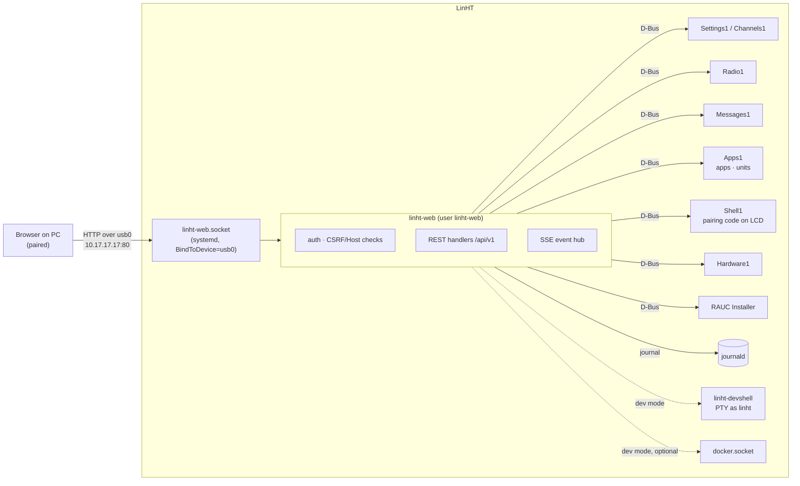
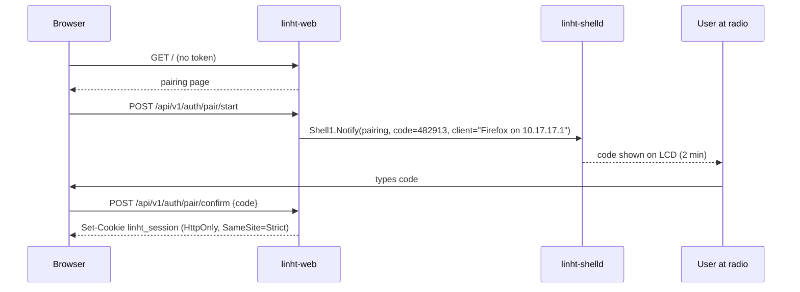

# linht-web v2: design

Status: **draft** · 2026-11-15 · companion to [architecture.md](architecture.md) (decisions D12, D13, D21–D26)

linht-web v2 is a rewrite of [OE3ANC/linht-web](https://github.com/OE3ANC/linht-web). It lives in the platform repo under `web/`, as its own Go module (D30). It stays Go, keeps the useful v1 features, and becomes what D12 asks for: **the remote UI of the platform**, built on the same D-Bus APIs as the on-device apps.

---

## 1. Why a rewrite

**What v1 does today** (commit `0e03fc7`, 2026-05-25):

| v1 plugin | What it does | v2 |
|---|---|---|
| `cps` | Loads and saves `/usr/share/linht/settings.yaml` directly (yaml.v3 node API, `os.WriteFile`) | **Replaced** by the Settings and Channels pages on `Settings1` / `Channels1`. Forms are generated from schemas. |
| `hardware` (+ `_sx1255`, `_spi`, `_gpio`, `_pe4312`, `_regs`) | Drives the SX1255 over SPI, the attenuators and the RF switch over GPIO, using its own pin config | **Removed.** Radio status goes through `Radio1`. Raw register and attenuator access is only available through a `radiod` maintenance lease, in developer mode. |
| `services` | `systemctl` and `journalctl` through `exec`, filtered on `linht-` | **Rewritten:** unit control through `Apps1.ControlUnit`, and logs from the journal (`journalctl -o json`). Scope is `linht-*` and app units. |
| `docker` | Image import and export, container create/start/stop/delete, logs | **Kept** as the optional *Containers* module. It only appears if docker is installed, and runs in developer mode. |
| `webshell` | PTY shell **as root** and `docker exec` into containers | **Kept** in developer mode. The shell runs as `linht` (sudo is available), never as root. |
| `filemanager` | Whole filesystem: upload, download, delete, mkdir | **Kept.** In normal mode it is limited to `/var/lib/linht/shared` and `/home/linht`. The whole filesystem is only reachable in developer mode. |
| – | – | **New:** Dashboard, Radio, Channels, Messages, Apps and Modes, System (OS update, backup and restore, paired browsers). |

**Problems that justify a rewrite** rather than incremental patches:

- **It runs as root on `0.0.0.0:80`, with no login.** Any program on the connected PC, and any website open in its browser, can reach a root shell.
- **It owns data and hardware it shouldn't:**
  - It writes `settings.yaml` non-atomically, with no notification.
  - It drives the SX1255 behind `gui_test`'s back.
  - It keeps a third copy of the RF pin numbers, which is the revision-drift problem (architecture §3).
- **Large uploads are held in RAM.** Fiber is used without request-body streaming and with a 10 GB body limit, so a large upload such as a container image or OS bundle can exhaust the 2 GB device.
- **The terminal page depends on the internet.** It loads xterm.js from `cdn.jsdelivr.net`, so it fails when the PC is offline, and third-party code runs on a page that holds a root shell.
- **docker is a hard dependency.** `Requires=docker.service` keeps about 120 MB of dockerd and containerd resident at all times.
- **The build is not reproducible.** The recipe runs `go mod init/tidy` with network access in `do_compile`, against `AUTOREV`.
- **The plugin list in `config.yaml` doesn't affect the UI.** The config itself notes this as a TODO.

---

## 2. Principles

1. **It owns no data and no hardware.** Every read and write goes through the platform's D-Bus services, with the same validation and permission checks as the device UIs (architecture §7).
2. **The UI is generated, not duplicated.** Settings forms come from the schemas (`Settings1.Describe`, architecture §8.3). The device's Settings app and the web page can't drift apart.
3. **It works offline.** It needs nothing from the internet. When the PC has internet, the browser acts as the bridge, for example for the app feed.
4. **It runs unprivileged.** It runs as `linht-web` behind a socket unit, and privileged operations are requested from the services that own them.
5. **It ships as one binary.** The frontend is embedded with `go:embed`, and the frontend has no build step.

---

## 3. Architecture



`linht-web` also exports a small interface so the device can manage pairings. It is D-Bus-activatable, so it works even while no browser is connected:

```text
org.m17project.LinHT.Web1      /org/m17project/LinHT/Web     (linht-web)
  ListPaired() → aa{sv}        id, name, user agent, created, last_seen
  Revoke(s id)
  signal PairingRequested(s client)   PairingCompleted(s id)
```

---

## 4. Security

### 4.1 Listening

- `linht-web.socket` has `ListenStream=10.17.17.17:80`, `BindToDevice=usb0` and `FreeBind=yes`, because usb0 may come up after the socket.
- systemd binds the socket, so the service needs no `CAP_NET_BIND_SERVICE` and no root.
- The service starts on the first connection and stops after an idle timeout. It uses no RAM while nobody is connected.

### 4.2 Pairing (D13)



- The code is 6 random digits, valid for 2 minutes, with at most 5 attempts. Further pairing attempts are rate-limited.
- The token is 32 random bytes. linht-web stores only its SHA-256, in `/var/lib/linht/web/paired.yaml` (YAML per D25). Pairings can be revoked on the device (Settings → Paired browsers, via `Web1.Revoke`) or in the web UI.
- **DNS rebinding and CSRF:**
  - The `Host` header must be `10.17.17.17` or `linht.local` (avahi is running).
  - Every state-changing request needs a matching `Origin` (or `Sec-Fetch-Site: same-origin`).
  - API bodies must be `application/json`.
  - The session cookie is `SameSite=Strict`.

  Without this, any website open in the PC's browser could POST to `http://10.17.17.17`.
- No TLS. The link is a point-to-point USB cable, and a self-signed certificate would only train users to click through warnings. This can be revisited if a network dongle (D23) becomes common.

### 4.3 Developer mode

Some pages are only available in developer mode: Shell, Files (whole filesystem), Containers, and Radio maintenance (raw registers and calibration).

- Developer mode is switched by `system.developer.enabled`, and **that key can only be changed on the device**. Its schema access level is `device-only`. A paired browser can therefore never give itself a root-capable shell.
- The **shell** comes from `linht-devshell`, a socket-activated helper (`Accept=yes`) running as `linht`. It allocates a PTY and execs a login shell. linht-web only bridges WebSocket and socket, and never spawns processes itself.
- **Containers** need access to the docker socket, which is root-equivalent. The `docker` group is therefore only added to linht-web through a drop-in that the Containers module installs when it is enabled.

### 4.4 Service permissions (D-Bus policy for user `linht-web`)

| Interface | Allowed |
|---|---|
| `Settings1` | read all; write `user` and `admin` access keys; `factory` only during a calibration session in developer mode |
| `Channels1`, `Messages1` | full. `Send` transmits, so linht-web holds `messages.send` / `radio.tx`; the user triggers each message explicitly |
| `Radio1` | status and events; `Tune`/`SetMode` as a user action; `Maintenance` only in developer mode; **no `Transmit`**, so there is no remote PTT |
| `Apps1` | install, remove, rollback, enable; `ListUnits`/`ControlUnit` limited to `linht-*` and `linht-app@*` |
| `Shell1` | `Notify` (pairing code) |
| `Hardware1` | read |
| RAUC `de.pengutronix.rauc.Installer` | `InstallBundle`, status properties |
| journal | via group `systemd-journal` |

---

## 5. HTTP API

REST with JSON under `/api/v1`. One SSE stream carries all live data. Every handler is a thin mapping onto a D-Bus call:

| Endpoint | D-Bus | Notes |
|---|---|---|
| `GET /status` | `Hardware1`, `Radio1`, gpsd, RAUC slot status | dashboard summary |
| `GET /settings` · `GET /settings/{ns}` | `ListNamespaces` · `GetAll` + `Describe` | values plus the schema in one response |
| `PATCH /settings/{ns}` · `DELETE /settings/{ns}/{key}` | `SetMany` (atomic) · `Reset` | schema validation errors come back per key |
| `GET/PUT/DELETE /channels[/{id}]`, `POST /channels/import`, `GET /channels/export` | `Channels1` | CSV in and out |
| `GET /messages`, `POST /messages`, `POST /messages/{id}/read`, `DELETE /messages/{id}` | `Messages1` | |
| `GET /radio`, `POST /radio/tune`, `POST /radio/mode` | `Radio1` | short lease per action |
| `POST /radio/maintenance` + `…/registers/{addr}`, `…/attenuators`, `…/rfswitch` | `Radio1` maintenance lease | developer mode; TX path blocked unless explicitly allowed |
| `GET /apps`, `POST /apps` (upload `.lapp`), `DELETE /apps/{id}`, `POST /apps/{id}/rollback`, `PATCH /apps/{id}/components/{c}` | `Apps1` | the upload is streamed to disk and passed to `appd` as an fd |
| `POST /modes` (upload `.grc` + name and parameter mapping) | generates a mode-only `.lapp` → `Apps1.Install` | the drag-and-drop flowgraph path (architecture §7.3) |
| `GET /system/update`, `POST /system/update` (upload RAUC bundle) | RAUC `InstallBundle` | D24; progress arrives over SSE |
| `GET /system/backup`, `POST /system/restore` | `Settings1.Export/Import`, `Channels1`, `Messages1`, `appdata` | one `.tar.zst` with calibration (D8) |
| `GET /system/units`, `POST /system/units/{name}/{action}`, `GET /system/units/{name}/logs` | `Apps1.ListUnits/ControlUnit`, journal | logs over SSE |
| `GET/DELETE /system/paired[/{id}]` | `Web1` | |
| `POST /auth/pair/start`, `POST /auth/pair/confirm`, `POST /auth/logout` | `Shell1.Notify` | |
| `GET /modules` | – | the pages that are available right now (developer mode, docker present, …) |
| `GET /events` (SSE) | D-Bus signals fan-out | typed events, replayed after reconnect through `Last-Event-ID` |
| `/dev/shell` (WebSocket), `/dev/files/…`, `/dev/containers/…` | `linht-devshell`, filesystem, docker API | developer mode |

The SSE stream carries these event types: `settings.changed`, `channels.changed`, `radio.state`, `radio.stream`, `messages.received`, `apps.job`, `units.changed`, `system.update`, `notification`.

---

## 6. Frontend

- **Plain JavaScript ES modules with no build step**, as in v1, embedded into the binary. **xterm.js is vendored**, with no CDN, so everything works offline.
- **Pages:**
  - Dashboard
  - Radio
  - Channels (table editor, CSV)
  - Messages
  - Settings (generated)
  - Apps, with Modes as a sub-tab
  - System (update, backup, units and logs, paired browsers)
  - Developer (Shell, Files, Containers, Maintenance), only when `/modules` reports it
- **Schema form renderer.** One component renders any namespace from its `Describe()` schema. It maps `bool` to a toggle, `int`/`float` with min and max to a number field or slider, `enum`/`choices` to a select, `frequency` to a MHz input, `callsign` to an upper-case pattern field, and `secret` to a write-only field. Keys whose `apply` isn't `live` show a hint such as "applies after restart of …".
- **App feed (phase 4).** The page fetches the feed's `index.json` and the bundle **in the browser**, then uploads it to the device. The device needs no internet access. The feed must be served from a CORS-enabled host (e.g. GitHub Pages; check its CORS headers before relying on it).
- **Mock mode.** `linht-web --session-bus` runs on a PC against the same Python mock services as the desktop simulator (architecture §12), so frontend work needs no hardware.

---

## 7. Implementation

- **Go, using stdlib `net/http`** (Go 1.22+ `ServeMux` patterns; scarthgap's Go is new enough) instead of Fiber/fasthttp. Uploads are streamed to disk, SSE and WebSocket use the standard library, and there are fewer dependencies. For an on-device web UI that doesn't need fasthttp's throughput, this is the better trade.
- **Dependencies:**
  - `github.com/godbus/dbus/v5`
  - `gopkg.in/yaml.v3`
  - `github.com/coder/websocket`
  - the docker client, only in the Containers module behind the build tag `containers`, so the default binary stays small
  - `creack/pty`, only in `linht-devshell`
- **Layout:**
  ```
  cmd/linht-web/            main, config, systemd socket activation (sd_listen_fds)
  cmd/linht-devshell/       PTY helper, socket-activated, runs as linht
  internal/auth/            pairing, tokens, Host/Origin/CSRF middleware
  internal/bus/             D-Bus clients generated from the introspection XML in ../interfaces/
  internal/events/          SSE hub, signal fan-out, replay buffer
  internal/api/<module>/    settings, channels, radio, messages, apps, modes, system, dev
  internal/modules/containers/   optional (build tag)
  ui/                       embedded frontend
  ```
- **Module interface**, replacing v1's `Plugin`:
  ```go
  type Module interface {
      Name() string
      Routes(mux *http.ServeMux)
      Available(ctx context.Context) bool  // dev mode, docker present, …
      Events() <-chan events.Event         // optional, nil if none
  }
  ```
  `/api/v1/modules` reports the modules that are `Available`, which fixes v1's "plugins list does not change the UI".
- **Configuration:** `/etc/linht/web.yaml` holds only web-specific items: upload limits, feed URL and idle timeout. All pin, SX1255, settings-path and docker-socket entries go away. The listen address comes from the socket unit.
- **systemd units:**
  - `linht-web.socket`
  - `linht-web.service`, with `User=linht-web`, `SupplementaryGroups=systemd-journal`, `ProtectSystem=strict`, `ReadWritePaths=/var/lib/linht/web`, `NoNewPrivileges=yes`, and no `Requires=docker.service`
  - `linht-devshell.socket` with `linht-devshell@.service`
  - a D-Bus service file for `org.m17project.LinHT.Web`
- **Yocto:**
  - a recipe in `contrib/yocto/` that builds `web/` from this repo like `linht-platform.bb`, with vendored modules and no network in `do_compile`
  - `useradd` for `linht-web`
  - `LICENSE = "GPL-3.0-only"` (D20)
  - docker moves out of the default `RDEPENDS` into a separate `linht-web-containers` package

### 7.1 Migration and milestones

v1 stays on `main` until the services it would talk to exist. Each v2 milestone ships with the architecture phase that provides its APIs:

| v2 milestone | Architecture phase | Contents |
|---|---|---|
| **W1** skeleton | phase 1 (prototype 1) | socket activation, pairing via `Shell1`, Host/CSRF checks, generated Settings page on `Settings1`, units and logs, vendored xterm and developer Shell via `linht-devshell`, mock mode |
| **W2** radio | phase 2 | Dashboard, Radio, Channels (replaces v1 CPS), Messages, maintenance and calibration (replaces v1 hardware), backup and restore; v1 retired |
| **W3** apps | phase 3 | Apps page, `.lapp` upload, Modes (`.grc` upload), Containers module |
| **W4** updates | phase 4 | RAUC upload and progress (D24), browser-side app feed |
